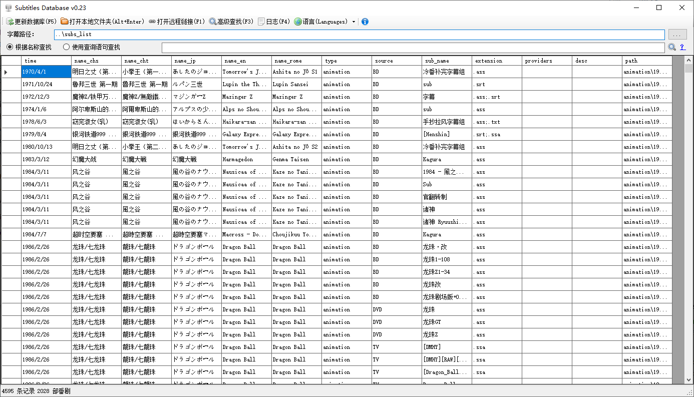
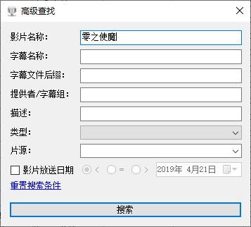
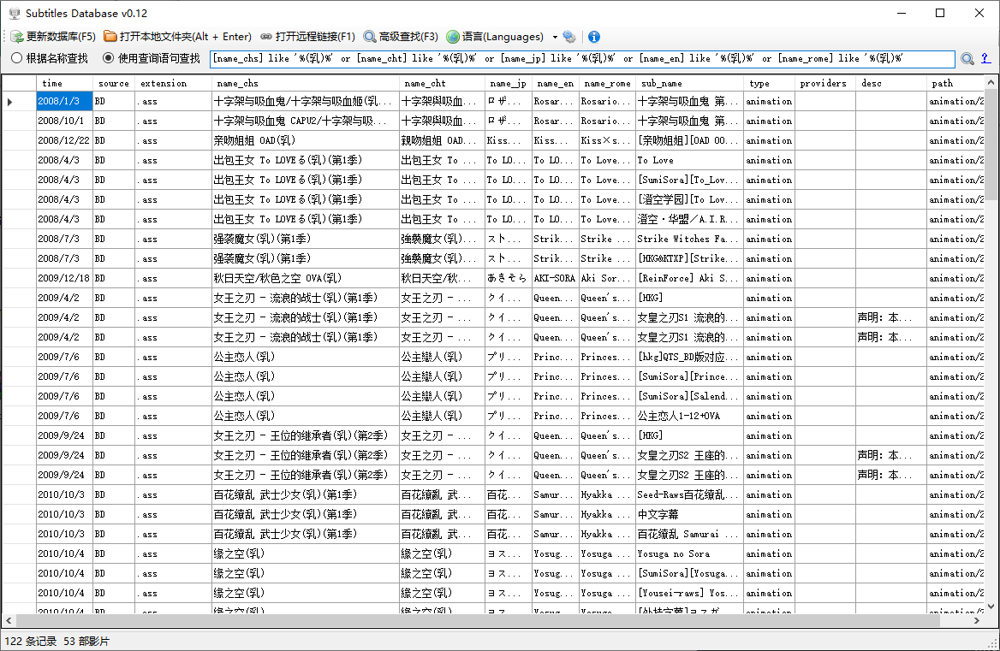

# 字幕共享计划 · sub_share

> **【注意】** 2025.9.22 开始，本人所有 GitHub 项目将不再更新。由于 GitHub 恶心的强制 2FA，导致 GitHub 账号在浏览器无法登陆（似乎 TortoiseGit 目前还可以，但不知道能坚持多久）。最新的项目仓库地址将在以后公布，请持续关注本人网站（[www.acgdev.com](https://www.acgdev.com)）。

字幕共享计划旨在改进目前字幕的共享和下载方式，让**共享字幕、搜索字幕、下载字幕**变得更简便。为此制作了 `Subtitles DataBase` 工具，并提供现代化重写版 **SubAtlas**。

---

## 目录

- [桌面客户端 SubAtlas（推荐）](#桌面客户端-subatlas推荐)
- [原版 Subtitles DataBase](#原版-subtitles-database)
- [下载方式选择](#下载方式选择)
- [字幕提交格式](#字幕提交格式)
- [参与与联系](#参与与联系)
- [附录](#附录)

---

## 桌面客户端 SubAtlas（推荐）

**SubAtlas ── 字幕库**：`Subtitles DataBase` 的 Rust + GPUI 现代化重写版，单文件免安装，界面更现代、搜索更快，并支持 JSON + zstd 压缩数据库。

| 资源 | 链接 |
| --- | --- |
| ⬇️ **下载 SubAtlas.exe**（Windows 10/11 x64，约 26 MB） | [直接下载](https://github.com/foxofice/sub_share/raw/master/Subtitles%20DataBase/SubAtlas/SubAtlas.exe) |
| 📖 使用说明与源码 | [Subtitles DataBase/SubAtlas](https://github.com/foxofice/sub_share/tree/master/Subtitles%20DataBase/SubAtlas) |
| 🌐 在线字幕站（浏览器检索） | [foxofice.github.io/sub_share](https://foxofice.github.io/sub_share/) |

主要能力：

- **字幕库**：数据表浏览、列排序、简繁自动转换搜索、类型/片源筛选，双击打开本地字幕目录
- **更新数据库**：远程同步（优先 `db.json.zst`，自动回退 `db.xml`，自适应多连接 / 断点续传）与本地扫描（全部 / 按类型+年份）
- **高级查找**：番剧名、字幕名、后缀、片源、字幕组、描述、放送日期
- **单包 exe**：除数据库文件外无外部依赖；支持深浅色主题与界面动效

---

## 原版 Subtitles DataBase



原版工具（.NET WinForms）有几处需要说明的地方：

**`更新数据库`**：根据本地数据生成数据库（主要给字幕上传者使用）

**`高级查找`**：使用各种条件搜索



**`查询语句`**：使用类似 SQL 的语法进行查询，比如

```sql
[time] >= '2010.1.1' and [time] <= '2011.1.1' and [extension] like '%srt%'
```

如果不熟悉 SQL 的用户，可以使用「高级查找」界面，效果差不多。



---

## 下载方式选择

**如果你是收藏党**，打算下载所有字幕到本地计算机：

> 你可以检出我们的整个 git 仓库（包含「Subtitles DataBase」工具及源代码、仓库中的所有字幕文件）。

**如果你只是追番党**，不打算下载所有字幕文件到本地计算机：

> 只下载 Subtitles DataBase 工具（原版不到 1 MB，SubAtlas 约 26 MB），选定需要的记录后，点击顶部菜单的【打开远程链接】就会在网站上显示你需要的结果。

---

## 字幕提交格式

提交字幕一般的格式如下（也可以直接参考 git 仓库中已提交的字幕）。

### 目录结构

**影片说明文件**（可忽略，但不建议忽略）

```text
subs_list/<type>/<year>/(<date>)<name>/info.txt
```

例如：

```text
subs_list/animation/2015/(2015.7.4)夏洛特 Charlotte
```

**字幕文件**

```text
subs_list/<type>/<year>/(<date>)<name>/<source>/<sub_name>/<字幕文件>
```

例如：

```text
subs_list/animation/2015/(2015.7.4)夏洛特 Charlotte/TV/[诸神字幕组][Charlotte 夏洛特][简繁日双语字幕][01-13][TVrip][1080P]/[kamigami] Charlotte - 01 [1920×1080 x264 AAC Sub(Chs,Cht,Jap)].Chs-Jap.ass
```

**字幕补充说明**（可忽略，用于添加字幕提供者/字幕组、字幕说明等）

```text
subs_list/<type>/<year>/(<date>)<name>/<source>/<sub_name>.txt
```

例如：

```text
subs_list/animation/2015/(2015.7.4)夏洛特 Charlotte/TV/[诸神字幕组][Charlotte 夏洛特][简繁日双语字幕][01-13][TVrip][1080P].txt
```

### 参数说明

| 参数 | 说明 |
| --- | --- |
| `<type>` | 分类，例如 `animation`、`movie` 等，可自行添加。`animation` 表示动画。同时欢迎大家提交里番字幕 |
| `<year>` | 影片放送的年份 |
| `<date>` | 影片放送的日期；如果不知道具体哪天，可以写成 `(1998)` 或 `(1998.5)`，忽略月、日 |
| `<name>` | 影片名字 |
| `<source>` | 匹配的源，例如 `BD`、`TV`、`Web`、`test` 等，可自行添加；但为了方便查找应该尽量统一。`BD` 表示 BDrip，`test` 表示未校对 |
| `<sub_name>` | 一整套字幕的名称 |
| `<字幕文件>` | 例如 `01.ass` |

### 示例

**最简单的例子可以参考：**

```text
subs_list/animation/2003/(2003.10.4)暗与帽子与书之旅人
```

**有个复杂的例子（包括 info.txt、各种字幕说明），可以参考：**

```text
subs_list/animation/2015/(2015.7.4)夏洛特 Charlotte
```

> **【为了多语言兼容性，提交的所有文本格式的文件，请尽量使用 `UTF-8` 编码】**

---

## 参与与联系

注意：由于字幕太多，可能部分字幕缺少出处或必要的补充说明，可以联系本人修改或补充、或者直接取得提交权限自行修改。

需要提交权限的同学可以联系我，欢迎各字幕组和手抄大佬加入。

Q 群：`1003173547`（群主大号已炸，现在 🐶tx 的东西一点都不能用。后续会更新 IM 的新版本，等更新完毕后将正式对外开放使用）

---

## 附录

```text
8B71A5DF03C47F647336BC78402E5F8E18E77A5242C5FCD7C811E65406B457711FB2239EC33AB27BDA8B6102B4929301
aes_cfb_decrypt(code, sha384(user).left(32), sha384(user).right(16).reverse())
```
