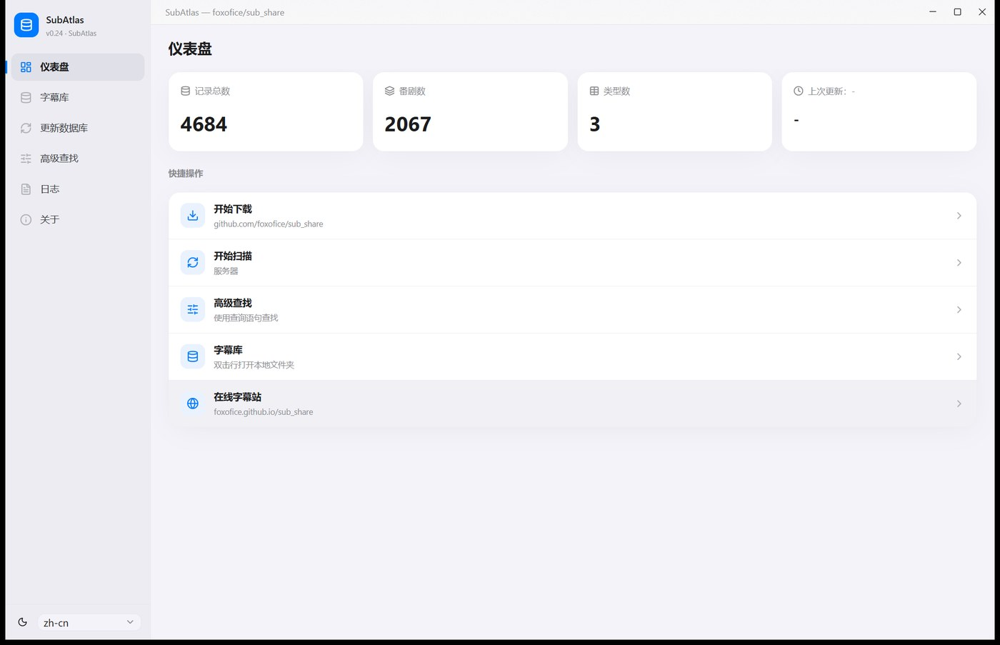
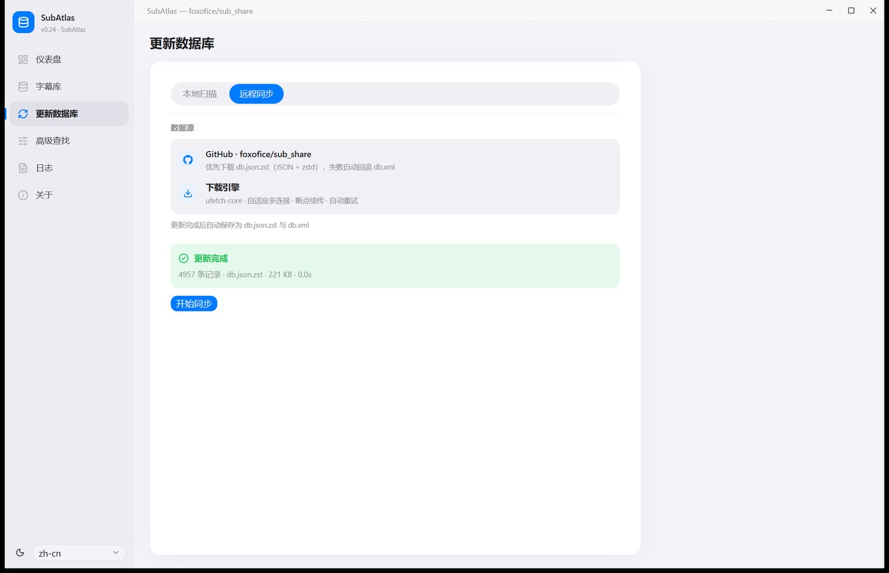
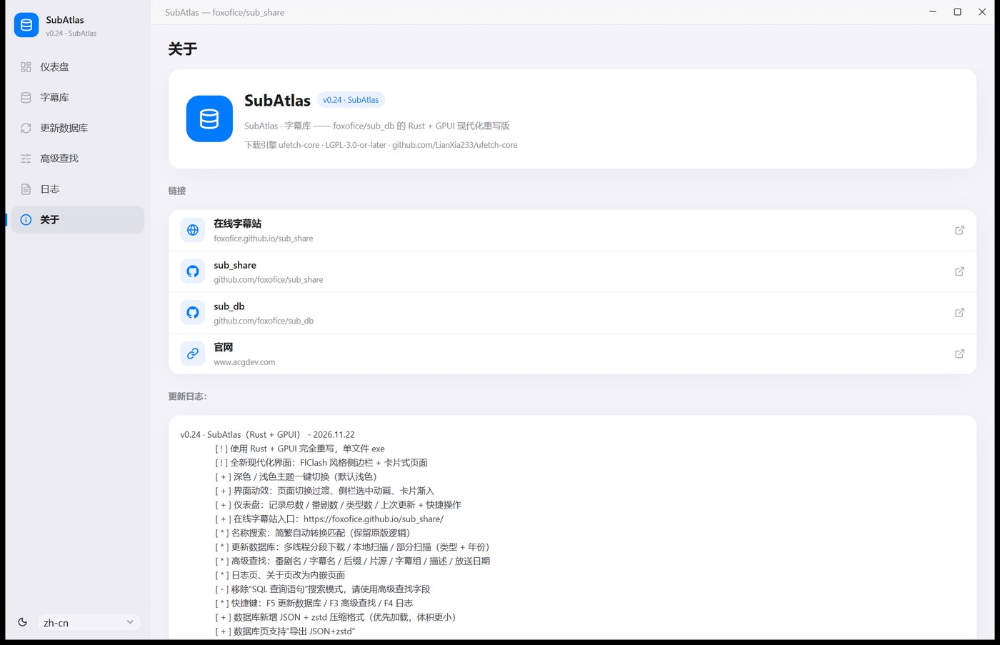

# SubAtlas · 字幕库

**SubAtlas** 是 [foxofice/sub_db](https://github.com/foxofice/sub_db)（Subtitles Database）的现代化重写版：
**Rust + GPUI** 构建的原生桌面应用，单文件 exe，FlClash 风格界面，专注「字幕共享计划」（[foxofice/sub_share](https://github.com/foxofice/sub_share)）的本地检索与数据同步。

- 在线字幕站：[https://foxofice.github.io/sub_share/](https://foxofice.github.io/sub_share/)
- 数据仓库：[foxofice/sub_share · Subtitles DataBase](https://github.com/foxofice/sub_share/tree/master/Subtitles%20DataBase)



---

## 功能特性

### 仪表盘
- 记录总数 / 番剧数 / 类型数 / 上次更新时间 四张统计卡
- 快捷操作：开始下载、开始扫描、高级查找、字幕库、**在线字幕站**
- 卡片错峰渐入动效

### 字幕库（数据表）
- 13 列数据表（时间 / 简繁日英罗马音名称 / 类型 / 片源 / 字幕名 / 后缀 / 字幕组 / 描述 / 路径）
- 列宽拖拽、列排序（自然排序，数字按大小）
- 即时搜索：**简繁自动转换组合匹配**（与原版一致的 LCMapString 逻辑）
- 类型 / 片源快捷筛选、一键重置
- 双击行打开本地字幕文件夹；右上角打开本地文件夹 / GitHub 远程目录
- 右上角**导出 JSON + zstd**（原生保存对话框）

### 更新数据库
| 方式 | 说明 |
| --- | --- |
| 远程同步 | 优先下载 **`db.json.zst`（JSON + zstd）**，不可用时自动回退 `db.xml`；完成后两种格式同时落盘 |
| 本地扫描 | 扫描 `类型\年份\(日期)名称\片源\字幕` 目录树，支持**全部扫描**或**部分扫描**（按类型 + 年份） |
| 首次运行 | 本地无数据库时**自动远程下载**并进入字幕库 |
| 容错 | 本地路径不存在时自动切换为远程同步 |

- 下载引擎：**ufetch-core** —— 自适应多连接、慢段接管、断点续传、自动重试
- 进度面板：已下载/总量 · 实时速度 · 百分比
- 完成态：绿色结果卡（例：`✓ 更新完成 · 4957 条记录 · db.json.zst · 221 KB · 0.0s`），失败为红色错误卡
- 日志明确记录实际同步的文件与大小
- **数据库保存位置**：默认在程序目录 `Files\`，也可在更新页点击「选择文件夹…」指定其他目录；切换时自动复制现有数据库（`db.json.zst` / `db.xml`），「恢复默认」可切回程序目录。位置记录在 `config.txt` 的 `db.path`



### 高级查找
- 番剧名称（简繁自动匹配）、字幕名称、后缀、片源、字幕组、描述
- 放送日期比较：`=` / `<` / `<=` / `>` / `>=`
- 搜索后自动跳转到字幕库展示结果

### 其他
- **深 / 浅色主题**一键切换（默认浅色）；页面切换淡入、侧栏选中胶囊、主题切换淡入等动效
- 日志页、关于页（内嵌更新日志、在线字幕站与仓库链接）
- 快捷键：`F5` 更新数据库、`F3` 高级查找、`F4` 日志
- **单包 exe**：语言表、更新日志、关于页内容全部内嵌，除数据库文件外无任何外部依赖



---

## 获取

- **预编译版本**：本目录下的 [`SubAtlas.exe`](SubAtlas.exe)（Windows 10/11 x64，单文件免安装）
- **源码**：`src/`、`Cargo.toml`，构建方式见下方「构建」

---

## 运行

1. 下载 / 构建 `SubAtlas.exe`；
2. 放置到任意可写目录，直接双击运行；
3. 程序在 exe 同级使用 `Files\` 目录：

| 文件 | 说明 | 必需 |
| --- | --- | --- |
| `Files\db.json.zst` | **首选**数据库（zstd 压缩的 JSON） | 可选（缺失时自动下载） |
| `Files\db.xml` | 兼容格式（.NET DataTable XML，供原版工具使用） | 可选 |
| `Files\config.txt` | 窗口位置/大小、列宽、字幕库路径、数据库保存位置（`db.path`） | 自动生成 |

> 数据库保存位置可通过「更新数据库 → 数据库保存位置 → 选择文件夹…」更改（默认 `Files\`，切换时自动复制现有数据库）。

环境要求：Windows 10/11（x64）。无需安装 .NET / 运行库。

---

## 构建

```powershell
# 需要 Rust 1.88+（edition 2024）与 MSVC Build Tools
cargo build --release
# 产物：target\release\SubAtlas.exe（约 26 MB，静态依赖）
```
**路径脱敏构建（推荐用于分发）**：Rust 会把依赖源码路径写入 panic 元数据，
因此二进制中可能带有构建机的用户名/缓存路径。发布前可用编译器前缀重映射抹除：

```powershell
# 注意：rustc 对同一路径取「最后一条匹配」的规则，因此通用规则放最前、具体规则放最后。
$env:RUSTFLAGS = @(
  "--remap-path-prefix=$env:USERPROFILE=~",
  "--remap-path-prefix=$env:USERPROFILE/.cargo/registry=cargo/registry",
  "--remap-path-prefix=$env:USERPROFILE/.cargo/git=cargo/git",
  "--remap-path-prefix=$PWD=subatlas"
) -join ' '
cargo build --release
```

依赖要点：

- `gpui-kit` / `gpui-component`（GPUI 组件库，Lucide 图标）
- `ufetch-core`（git 依赖，下载引擎，LGPL-3.0-or-later）
- `serde` / `serde_json` / `zstd`（JSON + zstd 数据库）
- `rfd`（原生保存对话框）

---

## 目录结构

```
src/
  main.rs      程序入口：GPUI 应用、主题、全局状态
  app.rs       全局状态（配置 / 数据库 / 语言 / 日志 / 过滤器）
  ui.rs        应用外壳：侧边栏导航、仪表盘、字幕库页面、动效
  windows.rs   更新数据库、高级查找、日志、关于页面 + 导出
  theme.rs     FlClash 配色（浅色/深色语义主题）
  db.rs        数据模型 + db.json.zst / db.xml 读写与自动迁移
  scan.rs      本地目录扫描（全部/部分扫描）
  search.rs    简繁组合搜索与过滤
  dl.rs        ufetch-core 下载封装（进度/取消）
  config.rs    config.txt 读写（兼容原版键名）
  i18n.rs      内置中英文语言表 + Files\Languages 扩展
assets/        应用图标、上游更新日志（内嵌）
docs/          README 截图
```

---

## 数据格式

### `db.json.zst`（首选）

`zstd(JSON array)`，每个元素：

```json
{
  "time": "1970-04-01",
  "name_chs": "明日之丈（第一部）",
  "name_cht": "小拳王（第一部）",
  "name_jp": "あしたのジョー S1",
  "name_en": "Tomorrow's Joe S1",
  "name_rome": "Ashita no Jō S1",
  "type": "animation",
  "source": "BD",
  "sub_name": "冷番补完字幕组",
  "extension": ".ass",
  "providers": "",
  "desc": "",
  "path": "animation\\1970\\(1970.4.1)明日之丈 第1季"
}
```

压缩效果参考：`db.xml` 约 2.9 MB → `db.json.zst` 约 **220–235 KB（≈8%）**。

### 加载与回退规则

1. 同时存在两种文件时，按**修改时间**选择较新的一个；
2. 仅存在 `db.xml` 时解析后**自动迁移**生成 `db.json.zst`；
3. `db.json.zst` 损坏时回退 `db.xml`；
4. 本地扫描 / 远程同步完成后**同时写入**两种格式（保持与原版工具兼容）。

> 上游 `db.json.zst` 由本工具生成并提交到 [Subtitles DataBase/Files](https://github.com/foxofice/sub_share/tree/master/Subtitles%20DataBase/Files)。

---

## 与上游 sub_db 的差异

- 界面：单窗口 + 侧边栏导航 + 卡片式页面（FlClash 风格），替代多窗口 WinForms
- 存储：新增 JSON + zstd 优先格式，XML 完整保留
- 下载：ufetch-core 引擎替代原多线程 Range 下载
- 移除「SQL 查询语句」模式，改用高级查找字段组合
- 快捷键调整：`F5` 更新数据库 / `F3` 高级查找 / `F4` 日志

---

## 许可证与致谢

本项目以 **LGPL-3.0-or-later** 发布；静态链接的 [ufetch-core](https://github.com/LianXia233/ufetch-core) 同为 LGPL-3.0-or-later，按 LGPLv3 第 4 节提供可重新链接方式（源码随仓库提供）。

致谢：

- [foxofice/sub_db](https://github.com/foxofice/sub_db)、[foxofice/sub_share](https://github.com/foxofice/sub_share) —— 数据与原始设计
- [FlClash](https://github.com/chen08209/FlClash) —— 界面设计参考
- [GPUI](https://github.com/zed-industries/zed) / [gpui-kit](https://github.com/longbridge/gpui-kit) / [Lucide](https://lucide.dev) 图标
- [ufetch-core](https://github.com/LianXia233/ufetch-core) —— 下载引擎
